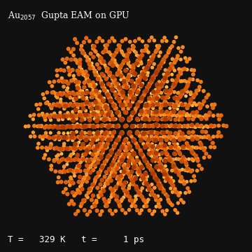
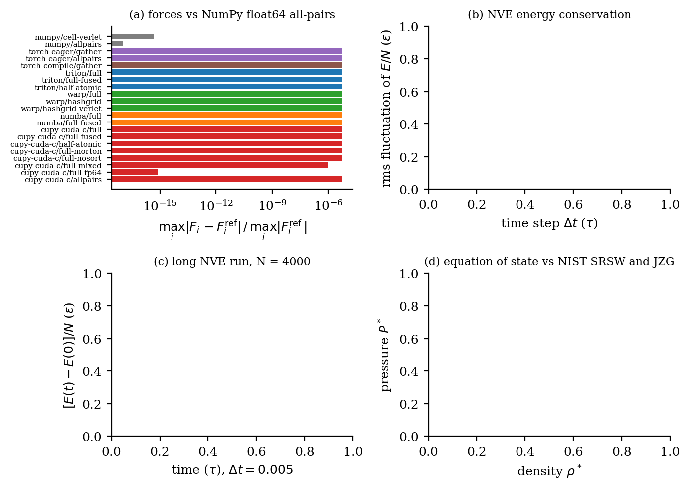
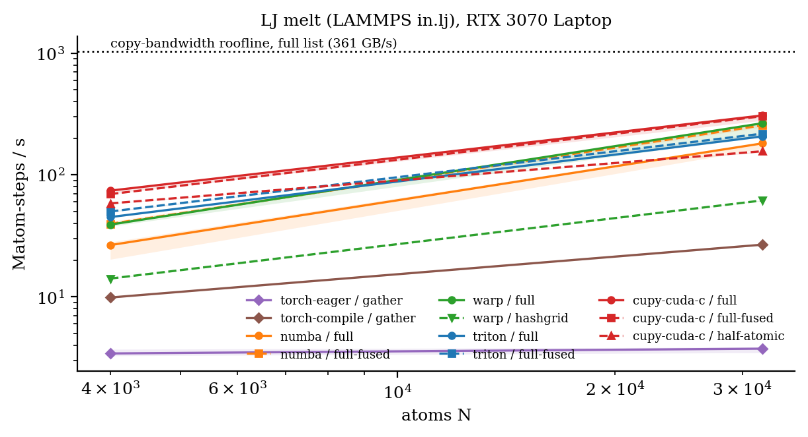
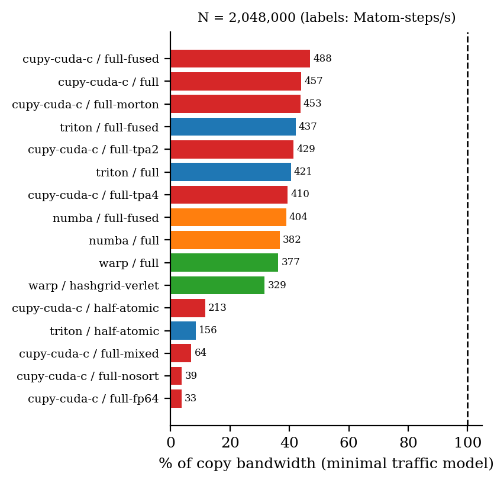

# pymd

**Lennard-Jones and EAM molecular dynamics at GPU speed from pure Python** — one integrator, seven
GPU programming models (NumPy, PyTorch eager, `torch.compile`, Triton, NVIDIA Warp, Numba-CUDA,
CUDA C via CuPy/NVRTC), every number reported against the hardware roofline.

[](https://github.com/walidhemati/pymd/actions/workflows/ci.yml)
[](LICENSE)
[](pyproject.toml)
[](paper/paper.pdf)

pymd is the Python successor to [yamd](https://github.com/walidhemati/yamd), the author's C++/Eigen
MD code: it keeps yamd's physics and test cases (LJ, velocity Verlet, Berendsen, cell-based
neighbor lists, Gupta potential for gold clusters) and moves the hot loops to the GPU.

<p align="center"></p>
<p align="center"><sub>Au<sub>2057</sub> Mackay icosahedron heated from 300 K to 1500 K (Gupta/EAM, CUDA C backend). Made by <code>figures/make_hero.py</code>.</sub></p>

## Headline result

<!-- HEADLINE:BEGIN -->
> **508 million atom-steps/s** on the LAMMPS `in.lj` LJ melt with 1,048,576 atoms (cupy-cuda-c / full-fused), **49% of the measured copy bandwidth** (361 GB/s, minimal-traffic model) on an NVIDIA GeForce RTX 3070 Laptop GPU; 451 ns/day for argon.  
> Source: `results/rtx3070-laptop.json`.
<!-- HEADLINE:END -->

## What's inside

| backend | variants | what it shows |
|---|---|---|
| `numpy` | `cell-verlet`, `allpairs` | float64 CPU oracle: argsort cell list, half pair list, `bincount` scatter |
| `torch-eager` | `gather`, `allpairs` | padded `(N, M)` neighbor matrix, gather-based forces |
| `torch-compile` | `gather` | the same, fused by TorchInductor into one Triton kernel |
| `triton` | `full`, `full-fused`, `half-atomic` | hand-written Triton kernels (list build, forces, integrator) |
| `warp` | `full`, `hashgrid`, `hashgrid-verlet` | hand-written cell list vs Warp's built-in `HashGrid` |
| `numba` | `full`, `full-fused` | `@cuda.jit` kernels incl. counting sort and scan |
| `cupy-cuda-c` | `full`, `full-fused`, `full-tpa2`, `full-tpa4`, `half-atomic`, `full-morton`, `full-nosort`, `full-mixed`, `full-fp64`, `allpairs` | hand-written CUDA C reference (NVRTC), ablations |

Physics and numerics: truncated (optionally shifted) LJ with periodic boundaries and minimum
image; velocity Verlet (fused kick-drift) and a one-kernel-per-step leapfrog; Berendsen and
Langevin (BAOAB) thermostats; FCC lattices; Gupta/second-moment EAM for gold with Mackay
icosahedra (port of yamd's `ih.C`). Neighbor search on the GPU: cell lists by counting sort
(atomic histogram, scan, scatter), atoms physically reordered by cell or Morton key, Verlet lists
with skin and LAMMPS-style rebuild policy (`every N`, `check yes/no`), plus an all-pairs baseline.

## Quick start

```bash
pip install -e ".[gpu]"          # or .[dev] for the CPU-only NumPy path
pymd backends                    # list what is available on this machine
pymd run --backend triton --cells 20 --steps 1000      # 32,000-atom in.lj melt, thermo output
pymd validate --quick            # physics checks -> results/validation.json
python bench/run.py --quick      # < 2 min benchmark smoke run
```

```python
from pymd import make_engine, fcc_lattice, maxwell_velocities, Langevin
pos, box = fcc_lattice(20, density=0.8442)
eng = make_engine("warp", "full", pos=pos, vel=maxwell_velocities(len(pos), 1.44), box=box)
eng.run(1000)
print(eng.thermo())           # epot, ekin, etot per atom, temperature, pressure
```

## Validation



* **Forces** of all 23 backend/variant combinations against a float64 NumPy direct sum
  (single precision: below 1e-5 relative to the largest force; fp64 variant: machine precision).
* **LAMMPS `bench/in.lj`**: step-0 potential energy and pressure reproduce the LAMMPS reference
  log (-6.7733681, -5.0197073); after 100 steps temperature, energies and pressure agree with the
  log within seed-to-seed scatter; same half-list length and number of rebuilds.
* **Energy conservation**: fluctuation scales as dt^2; long NVE drift for fp32, mixed and fp64.
* **Equation of state**: energy and pressure at the NIST SRSW Monte Carlo liquid state points
  (rc = 3 sigma + long-range corrections) and the Johnson-Zollweg-Gubbins (1993) MBWR equation.
* **g(r)** of the dense liquid, checked by thermodynamic consistency (energy and virial routes).
* **yamd cross-check**: on identical open-boundary systems pymd reproduces the C++ code's forces
  to ~1e-14 (LJ) and ~1e-15 (Gupta EAM).

Exact errors are in `results/validation.json` and the paper.

## Performance



<!-- PERF:BEGIN -->
Throughput at N = 2,048,000 (source `results/rtx3070-laptop.json`):

| backend | variant | Matom-steps/s | % copy BW | ns/day (Ar) |
|---|---|---:|---:|---:|
| cupy-cuda-c | full-fused | 488.0 | 47 | 222 |
| cupy-cuda-c | full | 456.6 | 44 | 208 |
| cupy-cuda-c | full-morton | 453.5 | 44 | 206 |
| triton | full-fused | 437.0 | 42 | 199 |
| cupy-cuda-c | full-tpa2 | 429.5 | 41 | 195 |
| triton | full | 420.5 | 41 | 191 |
| cupy-cuda-c | full-tpa4 | 409.6 | 39 | 186 |
| numba | full-fused | 403.8 | 39 | 184 |
| numba | full | 381.9 | 37 | 174 |
| warp | full | 376.6 | 36 | 171 |
| warp | hashgrid-verlet | 328.9 | 32 | 150 |
| cupy-cuda-c | half-atomic | 212.9 | 12 | 97 |
| triton | half-atomic | 156.1 | 9 | 71 |
| warp | hashgrid | 88.1 | - | 40 |
| cupy-cuda-c | full-mixed | 63.7 | 7 | 29 |
| cupy-cuda-c | full-nosort | 39.0 | 4 | 18 |
| cupy-cuda-c | full-fp64 | 33.4 | 4 | 15 |
<!-- PERF:END -->

"% copy BW" uses a minimal traffic model per atom-step: read x, read+write v, write x, plus 4 bytes
per stored neighbor-list entry (neighbor positions assumed cached, rebuilds ignored), so it is a
lower bound on the bandwidth actually used. Ceiling: 361 GB/s measured device-to-device copy
(448 GB/s spec) on an RTX 3070 Laptop GPU.



## How it works: the optimization ladder

1. **NumPy** (CPU, float64): vectorized cell list, half pair list, `bincount` scatter.
2. **PyTorch eager**: neighbor matrix + gather; every intermediate hits memory.
3. **`torch.compile`**: same code, Inductor fuses gather + pair math + reduction (writing it per
   Cartesian component was 3x faster than array-of-structs).
4. **Kernel languages** (Triton, Warp, Numba): one thread per atom, neighbor-major list for
   coalesced index reads, no atomics (full list), atoms sorted by cell so neighbor positions hit
   cache.
5. **Hand-written CUDA C** with `float4` positions, plus the advanced rungs: fused
   force+kick+drift (one launch per step), half lists with atomics, Morton ordering,
   mixed/fp64 precision.

## Same-GPU head-to-head with LAMMPS and HOOMD-blue

`bench/counterparts.py` runs LAMMPS (stable 30 Sep 2026; GPU and KOKKOS packages, float64 and
float32 builds via `bench/lammps/build_lammps.sh`) and HOOMD-blue 7.2.0 (conda-forge float64
build and a float32 source build, `bench/hoomd/build_hoomd_single.sh`) on the same GPU and the
same `in.lj` system, after checking that all codes integrate an identical initial state to the
same trajectory. Results: `results/counterparts.json`, `figures/counterparts.png` and the paper
(the current file is a `--quick` smoke run on a shared GPU, so its numbers are provisional).

## Head-to-head with yamd (C++)

`bench/yamd_compare.py` compiles yamd's own sources (`g++ -O3 -march=native`, single thread) next
to a small driver and runs the same open-boundary LJ blocks and Au clusters in both codes.
yamd's meson build needs MPI (not installed here), so its MPI-free library sources are compiled
directly. This is an apples-to-oranges comparison (one CPU core vs a GPU) kept to document the
lineage; see `figures/yamd_compare.png` and the paper.

## Reproduce the paper

```bash
python bench/run.py --full                 # results/rtx3070-laptop.json  (< 15 min, idle GPU)
python bench/yamd_compare.py               # results/yamd-compare.json    (needs a yamd checkout)
python bench/counterparts.py --full        # results/counterparts.json    (needs LAMMPS/HOOMD builds)
pymd validate                              # results/validation.json      (~20 min)
python figures/make_figures.py             # figures/*.pdf|png, paper/results.tex, README tables
python figures/make_hero.py                # docs/media/hero.gif
cd paper && tectonic paper.tex             # paper/paper.pdf
```

## Citation

```bibtex
@software{hemati2026pymd,
  author  = {Hemati, Walid},
  title   = {pymd: Lennard-Jones molecular dynamics at GPU speed from pure Python},
  year    = {2026},
  version = {0.1.0},
  url     = {https://github.com/walidhemati/pymd}
}
```

MIT license, see [LICENSE](LICENSE).

---

<sub>Part of the Python-HPC suite:
[pylbm](https://github.com/walidhemati/pylbm) ·
[pyheat3d](https://github.com/walidhemati/pyheat3d) ·
[pygravity](https://github.com/walidhemati/pygravity) ·
[pymd](https://github.com/walidhemati/pymd) ·
[pyising](https://github.com/walidhemati/pyising) ·
[pyspectral](https://github.com/walidhemati/pyspectral)</sub>
